# Análisis estadístico exploratorio — MetalNova Smart Factory BI

> **Todos los datos son sintéticos.** Este informe describe el dataset generado para el
> prototipo académico, no telemetría de una fábrica real. El escenario `calibracion` fue
> diseñado para mostrar señal (OEE ≈ 78 → 66 %). Las correlaciones son asociaciones
> descriptivas: **no implican causalidad**.

**Incremento:** 008 · **Ventana:** 2026-04-22 → 2026-10-18 (180 días) · **Corrida:** `eda-20261025T172443-9ba731`

---

## 1. Resumen ejecutivo

- Se analizaron **9.360** registros máquina-día, **28.080** máquina-turno, **76.021** paradas consolidadas y **401.787** eventos históricos.
- **OEE ponderado** del periodo: **71,96 %**. En la distribución por máquina-día, media **71,92 %**, mediana **72,28 %**, sd **6,41 pp** y rango 44,14 %–85,78 %.
- El componente más asociado al OEE es **rendimiento** (r = 0,983); la disponibilidad tiene poca varianza y actúa casi como techo.
- **P-SUR** presenta la mediana de OEE más baja (68,40 %) frente a **P-NORTE** (75,67 %); Kruskal–Wallis p < 1e-300, ε² = 0,234.
- **184** máquina-día (1,97 %) quedan fuera de las cercas IQR 1,5× del OEE; se clasifican y no se eliminan.
- La tendencia lineal del OEE es **-2,40 pp por 30 días** (R² = 0,98); las primeras 30 jornadas promedian 78,02 % y las últimas 66,00 %.
- La causa no planificada con más minutos es **Microparada** (71,8 % del downtime no planificado).
- Calidad de datos: **0** controles con fallas; latencia p95 de los eventos `sim-*` = **35,0 ms**.

La lectura de negocio es consistente con el resto del proyecto: la pérdida dominante es de
**rendimiento**, P-SUR concentra el peor desempeño y la energía por unidad buena se mueve en
sentido contrario al OEE. Este incremento aporta la evidencia estadística y su incertidumbre.

## 2. Datos, fuentes y método

### 2.1 Inventario

**Tabla T01. Inventario de fuentes y recuentos.**

| Objeto | Tipo | Filas totales | En ventana |
|---|---|---|---|
| fact_calidad | hecho | 28.080 | 28.080 |
| fact_evento | hecho | 401.838 | 401.787 |
| fact_mantenimiento | hecho | 2.628 | 2.628 |
| fact_parada | hecho | 76.045 | 76.021 |
| fact_produccion | hecho | 28.080 | 28.080 |
| dim_causa | dimensión | 13 | — |
| dim_familia | dimensión | 3 | — |
| dim_linea | dimensión | 6 | — |
| dim_maquina | dimensión | 52 | — |
| dim_orden | dimensión | 28.080 | 28.080 |
| dim_planta | dimensión | 3 | — |
| dim_producto | dimensión | 12 | — |
| dim_tecnico | dimensión | 12 | — |
| dim_tiempo | dimensión | 1.095 | 180 |
| dim_turno | dimensión | 3 | — |
| fact_evento_rechazado | cuarentena | 2 | — |

**Fuente de cada bloque:** los KPI y ratios se leen de las vistas `v_kpi_*` (contrato analítico);
las duraciones, costes y eventos se leen de los hechos; las dimensiones solo agrupan. No se
recalcula un KPI en Python si ya existe una vista validada.

### 2.2 Filtros y exclusiones

- Ventana: `2026-04-22 → 2026-10-18`, definida por `id_tiempo`/`fecha`.
- Paradas consolidadas analizadas: **76.021** (0 con solape; 0 min solapados).
- Se excluyen del análisis principal las **24 paradas** y **51 eventos** de la ingesta simulada
  (`Ingesta 004:%`, `run_id LIKE 'sim-%'`), todos del 2026-10-22 y fuera de la ventana. Se usan
  solo en latencia y calidad IoT. Los **2 eventos rechazados** son artefactos de la prueba G5.
- Los atípicos **no se eliminan**: se cuantifican y se contextualizan.

### 2.3 Niveles de análisis

| Nivel | n | Uso principal |
|---|---:|---|
| Fila de producción | 28.080 | conteos y energía por orden |
| Máquina-día | 9.360 | distribuciones, atípicos y comparaciones |
| Máquina-turno | 28.080 | correlación con MTBF/MTTR y turnos |
| Planta-día | 540 | serie temporal y ventanas |
| Máquina agregada | 52 | estabilidad y ranking |

## 3. Calidad de datos

**Tabla T02. Controles de integridad y duplicados.**

| Control | Fallas | Registros | Estado |
|---|---|---|---|
| calidad_conteos_incoherentes | 0 | 28.080 | OK |
| conteos_incoherentes | 0 | 28.080 | OK |
| duplicados_evento | 0 | 401.787 | OK |
| duplicados_parada | 0 | 76.021 | OK |
| duplicados_produccion | 0 | 28.080 | OK |
| invariante_calendario | 0 | 28.080 | OK |
| invariante_operativo | 0 | 28.080 | OK |
| mantenimiento_duracion_negativa | 0 | 2.628 | OK |
| oee_fuera_rango | 0 | 9.360 | OK |
| parada_duracion_negativa | 0 | 76.021 | OK |
| parada_fin_menor_inicio | 0 | 76.021 | OK |
| temperatura_fuera_rango | 0 | 58.776 | OK |

**Tabla T03. Nulos por variable clave.**

| Nivel | Variable | n | Nulos | % nulos | Nota |
|---|---|---|---|---|---|
| máquina-día | oee | 9.360 | 0 | 0,00 % |  |
| máquina-día | rendimiento | 9.360 | 0 | 0,00 % |  |
| máquina-día | calidad | 9.360 | 0 | 0,00 % |  |
| máquina-día | energia_por_unidad_buena | 9.360 | 0 | 0,00 % |  |
| máquina-turno | mtbf_h | 28.080 | 25.795 | 91,86 % | NULL esperado si no hubo fallas |
| máquina-turno | mttr_min | 28.080 | 25.795 | 91,86 % | NULL esperado si no hubo reparaciones |
| máquina-día | fpy | 9.360 | 0 | 0,00 % | NULL esperado si no hubo inspecciones |

Los `NULL` de MTBF, MTTR y FPY son **esperados** por la definición del KPI (sin fallas, sin
reparaciones o sin inspecciones) y no se imputan. No se detectaron duplicados ni violaciones
de invariantes en la ventana analizada.

**Tabla T04. Cobertura de señal IoT.**

| Estado | Máquina-día | Lecturas | Faltantes | % | Cumple cadencia |
|---|---|---|---|---|---|
| ok | 9.360 | 58.776 | 0 | 100,00 % | 0,0 % |

La cadencia de 15 min no se cumple porque el feed sintético emite dos lecturas por turno;
se reporta como diagnóstico y no se rellena con *carry-forward* (D-022). El feed produce 6, 9
o 12 lecturas por máquina-día y un hueco máximo de 210 min entre lecturas; todos los
máquina-día quedaron en estado `ok`. La distribución se muestra en la figura F15.

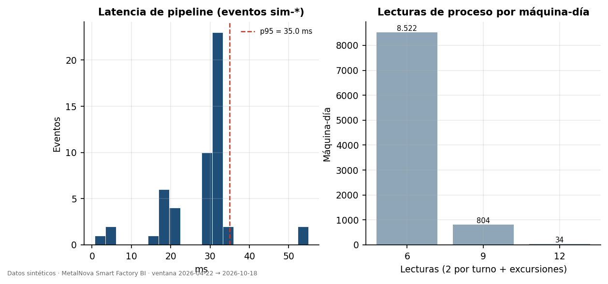

**Figura F15.** Latencia de pipeline de los eventos `sim-*` y lecturas de proceso por máquina-día. Fuente: `fact_evento` y `v_calidad_senal_iot`.

## 4. Estadística descriptiva

**Tabla T05. Descriptivos globales por nivel y variable.**

| Nivel | Variable | n | Media | Mediana | SD | CV | Mín | Q1 | Q3 | IQR | Máx | Asim. | Curt. |
|---|---|---|---|---|---|---|---|---|---|---|---|---|---|
| máquina-día | disponibilidad | 9.360 | 0,9879 | 0,9904 | 0,0096 | 0,0097 | 0,8800 | 0,9852 | 0,9941 | 0,0089 | 1,0000 | -2,5598 | 11,8745 |
| máquina-día | rendimiento | 9.360 | 0,7653 | 0,7701 | 0,0583 | 0,0762 | 0,5105 | 0,7334 | 0,8060 | 0,0726 | 0,8866 | -0,9113 | 1,6161 |
| máquina-día | calidad | 9.360 | 0,9503 | 0,9509 | 0,0127 | 0,0134 | 0,8978 | 0,9433 | 0,9592 | 0,0159 | 0,9747 | -1,0392 | 2,5831 |
| máquina-día | oee | 9.360 | 0,7192 | 0,7228 | 0,0641 | 0,0892 | 0,4414 | 0,6814 | 0,7652 | 0,0838 | 0,8578 | -0,6805 | 0,9847 |
| máquina-día | scrap_rate | 9.360 | 0,0497 | 0,0491 | 0,0127 | 0,2564 | 0,0253 | 0,0408 | 0,0567 | 0,0159 | 0,1022 | 1,0392 | 2,5831 |
| máquina-día | energia_por_unidad_buena | 9.360 | 0,3618 | 0,3370 | 0,1275 | 0,3525 | 0,1418 | 0,2674 | 0,4364 | 0,1690 | 0,8948 | 0,8343 | 0,4651 |
| máquina-día | downtime_no_planificado_pct | 9.360 | 0,0121 | 0,0096 | 0,0096 | 0,7903 | 0,0000 | 0,0059 | 0,0148 | 0,0089 | 0,1200 | 2,5598 | 11,8745 |
| máquina-día | downtime_no_planificado_min | 9.360 | 16,2213 | 13,0000 | 12,8251 | 0,7906 | 0,0000 | 8,0000 | 20,0000 | 12,0000 | 162,0000 | 2,5686 | 11,9643 |
| máquina-turno | mtbf_h | 2.285 | 6,9011 | 7,1500 | 0,8600 | 0,1246 | 2,8083 | 6,9667 | 7,2667 | 0,3000 | 7,4167 | -3,4759 | 11,3022 |
| máquina-turno | mttr_min | 2.285 | 17,8186 | 15,0000 | 12,3882 | 0,6952 | 5,0000 | 10,0000 | 22,0000 | 12,0000 | 135,0000 | 2,4859 | 11,5358 |
| máquina-turno | microparadas_por_100h | 28.080 | 21,2556 | 13,8249 | 16,8245 | 0,7915 | 0,0000 | 13,3630 | 27,7136 | 14,3506 | 75,9494 | 0,4990 | -0,6378 |
| máquina-turno | fallas_cortas_por_100h | 28.080 | 1,0535 | 0,0000 | 3,8871 | 3,6896 | 0,0000 | 0,0000 | 0,0000 | 0,0000 | 32,5203 | 3,7534 | 14,3412 |
| máquina-turno | costo_mantenimiento_usd | 28.080 | 52,9761 | 0,0000 | 197,3209 | 3,7247 | 0,0000 | 0,0000 | 0,0000 | 0,0000 | 2.511,0700 | 4,8519 | 28,9047 |
| parada no planificada | duracion_min | 46.085 | 3,2946 | 3,0000 | 4,5833 | 1,3912 | 1,0000 | 2,0000 | 4,0000 | 2,0000 | 135,0000 | 8,0012 | 101,4300 |
| parada planificada | duracion_min | 29.936 | 30,4557 | 30,0000 | 5,7256 | 0,1880 | 15,0000 | 30,0000 | 30,0000 | 0,0000 | 120,0000 | 10,4608 | 131,1839 |
| mantenimiento | duracion_min | 2.628 | 23,9737 | 16,0000 | 23,9049 | 0,9971 | 5,0000 | 10,0000 | 26,0000 | 16,0000 | 135,0000 | 2,2741 | 4,8312 |
| mantenimiento | costo_estimado_usd | 2.628 | 566,0456 | 489,4150 | 303,1675 | 0,5356 | 180,4700 | 380,6350 | 621,6050 | 240,9700 | 1.878,3200 | 1,9600 | 3,9308 |
| inspección | unidades_inspeccionadas | 28.080 | 503,6465 | 484,0000 | 123,7640 | 0,2457 | 179,0000 | 400,0000 | 601,0000 | 201,0000 | 828,0000 | 0,3899 | -0,8625 |
| inspección | tasa_defectos | 28.080 | 0,0498 | 0,0491 | 0,0131 | 0,2625 | 0,0216 | 0,0407 | 0,0572 | 0,0165 | 0,1028 | 0,9518 | 2,2534 |
| evento IoT | temperatura_c | 58.776 | 74,4425 | 73,6600 | 7,1491 | 0,0960 | 57,6500 | 69,5500 | 78,1500 | 8,6000 | 95,9900 | 0,7522 | 0,6304 |
| orden-máquina-turno | total_count | 28.080 | 503,6465 | 484,0000 | 123,7640 | 0,2457 | 179,0000 | 400,0000 | 601,0000 | 201,0000 | 828,0000 | 0,3899 | -0,8625 |
| orden-máquina-turno | good_count | 28.080 | 479,2646 | 460,0000 | 120,7730 | 0,2520 | 165,0000 | 379,0000 | 574,0000 | 195,0000 | 809,0000 | 0,4014 | -0,8046 |
| orden-máquina-turno | scrap_count | 28.080 | 24,3819 | 23,0000 | 6,8363 | 0,2804 | 10,0000 | 20,0000 | 28,0000 | 8,0000 | 72,0000 | 1,7958 | 7,6257 |

La tabla anterior usa la distribución de las **filas**, no el KPI ponderado. Por eso la media
de OEE (72 %) difiere del OEE ponderado global, que es el valor válido para el tablero.

**Tabla T06. OEE y componentes por planta (máquina-día).**

| Variable | Planta | n | Media | SD | Mediana [IC 95 %] |
|---|---|---|---|---|---|
| disponibilidad | P-NORTE | 3.240 | 98,88 % | 0,84 pp | 99,04 % [99,04 %; 99,11 %] |
| rendimiento | P-NORTE | 3.240 | 79,77 % | 4,57 pp | 79,95 % [79,70 %; 80,27 %] |
| calidad | P-NORTE | 3.240 | 95,77 % | 0,87 pp | 95,77 % [95,72 %; 95,82 %] |
| oee | P-NORTE | 3.240 | 75,59 % | 5,10 pp | 75,67 % [75,39 %; 75,95 %] |
| scrap_rate | P-NORTE | 3.240 | 4,23 % | 0,87 pp | 4,23 % [4,18 %; 4,28 %] |
| energia_por_unidad_buena | P-NORTE | 3.240 | 0,2994 kWh | 0,0794 kWh | 0,2886 kWh [0,2847; 0,2929] |
| downtime_no_planificado_pct | P-NORTE | 3.240 | 1,12 % | 0,84 pp | 0,96 % [0,89 %; 0,96 %] |
| disponibilidad | P-CENTRO | 3.240 | 98,81 % | 0,88 pp | 99,04 % [98,96 %; 99,04 %] |
| rendimiento | P-CENTRO | 3.240 | 76,63 % | 4,39 pp | 76,85 % [76,60 %; 77,03 %] |
| calidad | P-CENTRO | 3.240 | 95,00 % | 1,45 pp | 95,21 % [95,15 %; 95,26 %] |
| oee | P-CENTRO | 3.240 | 71,98 % | 5,00 pp | 71,92 % [71,69 %; 72,25 %] |
| scrap_rate | P-CENTRO | 3.240 | 5,00 % | 1,45 pp | 4,79 % [4,74 %; 4,85 %] |
| energia_por_unidad_buena | P-CENTRO | 3.240 | 0,3448 kWh | 0,1190 kWh | 0,3252 kWh [0,3199; 0,3317] |
| downtime_no_planificado_pct | P-CENTRO | 3.240 | 1,19 % | 0,88 pp | 0,96 % [0,96 %; 1,04 %] |
| disponibilidad | P-SUR | 2.880 | 98,67 % | 1,13 pp | 98,96 % [98,89 %; 98,96 %] |
| rendimiento | P-SUR | 2.880 | 72,78 % | 6,30 pp | 73,71 % [73,42 %; 73,99 %] |
| calidad | P-SUR | 2.880 | 94,22 % | 0,89 pp | 94,23 % [94,17 %; 94,27 %] |
| oee | P-SUR | 2.880 | 67,73 % | 6,61 pp | 68,40 % [68,07 %; 68,74 %] |
| scrap_rate | P-SUR | 2.880 | 5,78 % | 0,89 pp | 5,77 % [5,73 %; 5,83 %] |
| energia_por_unidad_buena | P-SUR | 2.880 | 0,4512 kWh | 0,1310 kWh | 0,4364 kWh [0,4304; 0,4435] |
| downtime_no_planificado_pct | P-SUR | 2.880 | 1,33 % | 1,13 pp | 1,04 % [1,04 %; 1,10 %] |

El intervalo de confianza de la mediana se obtuvo por bootstrap percentil (2.000 réplicas).

## 5. Distribuciones y normalidad

**Tabla T07. Pruebas de normalidad.**

| Nivel | Variable | n | Asimetría | Curtosis | D'Agostino | p D'Agostino | p Shapiro | Veredicto |
|---|---|---|---|---|---|---|---|---|
| máquina-día | oee | 9.360 | -0,6805 | 0,9847 | 777,7133 | 0,0000 | 0,0000 | no normal (α=0,05) |
| máquina-día | disponibilidad | 9.360 | -2,5598 | 11,8745 | 5.404,2067 | 0,0000 | 0,0000 | no normal (α=0,05) |
| máquina-día | rendimiento | 9.360 | -0,9113 | 1,6161 | 1.302,3882 | 0,0000 | 0,0000 | no normal (α=0,05) |
| máquina-día | calidad | 9.360 | -1,0392 | 2,5831 | 1.746,9034 | 0,0000 | 0,0000 | no normal (α=0,05) |
| máquina-día | scrap_rate | 9.360 | 1,0392 | 2,5831 | 1.746,9034 | 0,0000 | 0,0000 | no normal (α=0,05) |
| máquina-día | energia_por_unidad_buena | 9.360 | 0,8343 | 0,4651 | 894,5716 | 0,0000 | 0,0000 | no normal (α=0,05) |
| parada no planificada | duracion_min | 46.085 | 8,0012 | 101,4300 | 63.452,7924 | 0,0000 | 0,0000 | no normal (α=0,05) |
| evento IoT | temperatura_c | 58.776 | 0,7522 | 0,6304 | 5.016,9316 | 0,0000 | 0,0000 | no normal (α=0,05) |

Con n grande, D'Agostino detecta desviaciones mínimas de la normalidad; el QQ-plot y la
asimetría son más informativos. El OEE presenta una cola izquierda moderada: unos pocos
máquina-día muy por debajo del grueso de la distribución.

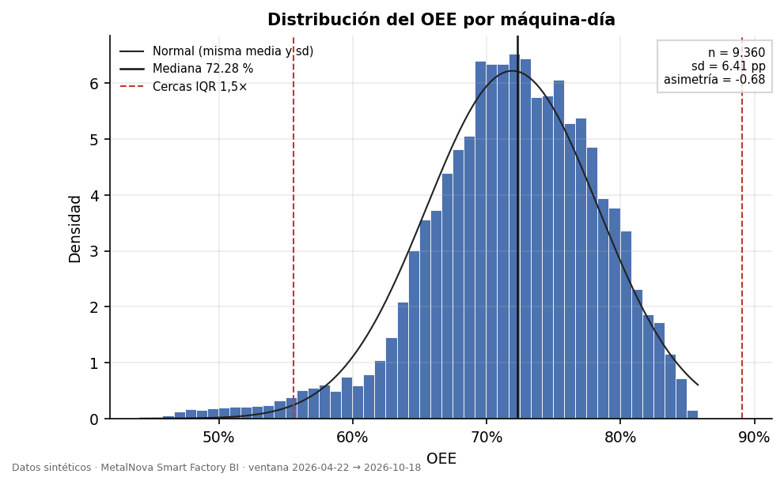

**Figura F01.** Histograma del OEE por máquina-día con mediana y cercas IQR 1,5×. Fuente: `v_kpi_oee_maquina_dia`; n = 9.360.

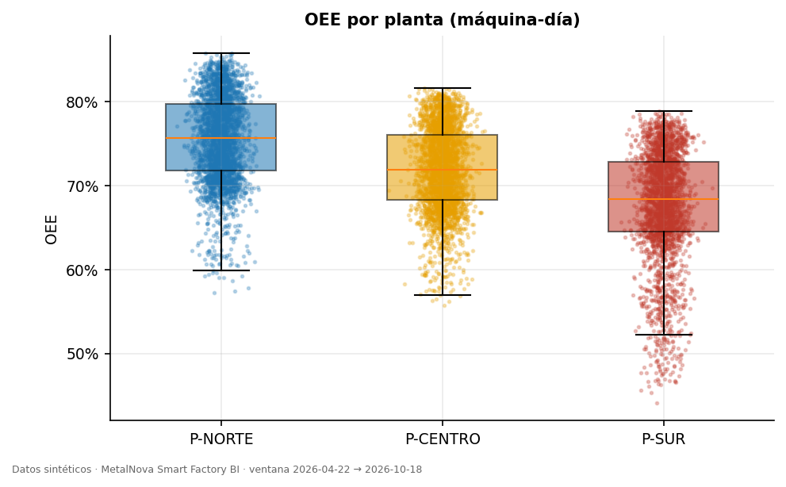

**Figura F02.** OEE por planta; la caja muestra Q1–Q3 y la mediana. Fuente: `v_kpi_oee_maquina_dia`.

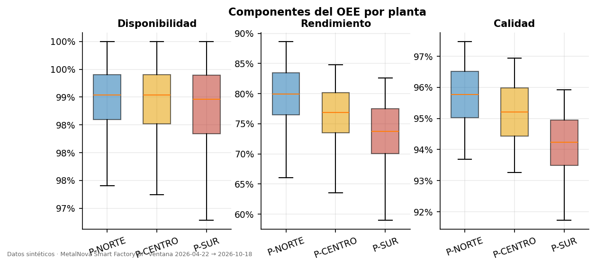

**Figura F03.** Disponibilidad, rendimiento y calidad por planta. Fuente: `v_kpi_oee_maquina_dia`.

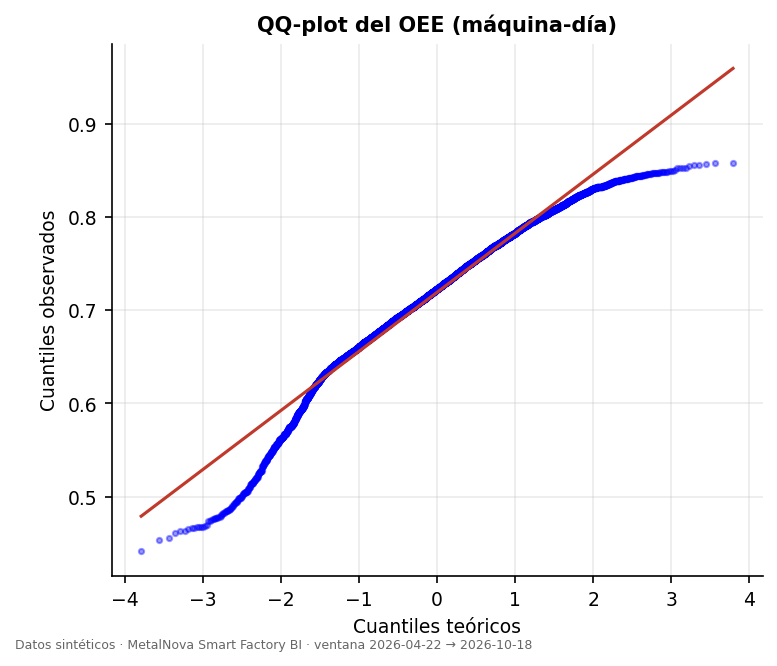

**Figura F07.** QQ-plot del OEE frente a una normal. Fuente: `v_kpi_oee_maquina_dia`.

## 6. Valores atípicos

Se aplican cuatro criterios: IQR 1,5×, IQR 3× (extremos), z-score |z|>3 y z-score
modificado (MAD) > 3,5. Un valor atípico no es un error: puede ser una máquina crítica, un
cambio de producto o un evento de demo. El análisis los **clasifica**, no los borra.

**Tabla T08. Atípicos por variable y método.**

| Nivel | Variable | n | n IQR | % IQR | n extremos | % extremos | n z>3 | % z>3 | n MAD | % MAD |
|---|---|---|---|---|---|---|---|---|---|---|
| máquina-día | oee | 9.360 | 184 | 1,97 % | 0 | 0,00 % | 109 | 1,16 % | 71 | 0,76 % |
| máquina-día | disponibilidad | 9.360 | 569 | 6,08 % | 170 | 1,82 % | 191 | 2,04 % | 384 | 4,10 % |
| máquina-día | rendimiento | 9.360 | 274 | 2,93 % | 3 | 0,03 % | 129 | 1,38 % | 113 | 1,21 % |
| máquina-día | calidad | 9.360 | 183 | 1,96 % | 0 | 0,00 % | 180 | 1,92 % | 177 | 1,89 % |
| máquina-día | scrap_rate | 9.360 | 183 | 1,96 % | 0 | 0,00 % | 180 | 1,92 % | 177 | 1,89 % |
| máquina-día | energia_por_unidad_buena | 9.360 | 152 | 1,62 % | 0 | 0,00 % | 63 | 0,67 % | 55 | 0,59 % |
| máquina-día | downtime_no_planificado_pct | 9.360 | 569 | 6,08 % | 170 | 1,82 % | 191 | 2,04 % | 384 | 4,10 % |
| parada no planificada | duracion_min | 46.085 | 2.038 | 4,42 % | 1.691 | 3,67 % | 931 | 2,02 % | 1.913 | 4,15 % |
| mantenimiento | duracion_min | 2.628 | 290 | 11,04 % | 170 | 6,47 % | 92 | 3,50 % | 278 | 10,58 % |
| mantenimiento | costo_estimado_usd | 2.628 | 259 | 9,86 % | 117 | 4,45 % | 85 | 3,23 % | 209 | 7,95 % |
| evento IoT | temperatura_c | 58.776 | 2.403 | 4,09 % | 0 | 0,00 % | 59 | 0,10 % | 70 | 0,12 % |

En el plano multivariante (A, P, Q), **548** de 9.360 máquina-día (5,85 %) superan la distancia de Mahalanobis con umbral χ² 97,5 % (3,06). La disponibilidad casi constante hace que el plano esté dominado por rendimiento y calidad: el porcentaje mide cola conjunta, no 548 errores.

**Tabla T09. Casos atípicos más extremos (|z| > 3).**

| Nivel | Variable | Valor | z | z modificado | Contexto |
|---|---|---|---|---|---|
| máquina-día | oee | 0,4414 | -4,33 | -4,55 | 2026-09-16 · M-047 · P-SUR · Prensa |
| máquina-día | oee | 0,4533 | -4,15 | -4,36 | 2026-10-18 · M-047 · P-SUR · Prensa |
| máquina-día | oee | 0,4560 | -4,11 | -4,32 | 2026-10-11 · M-047 · P-SUR · Prensa |
| máquina-día | oee | 0,4612 | -4,02 | -4,23 | 2026-10-10 · M-047 · P-SUR · Prensa |
| máquina-día | oee | 0,4628 | -4,00 | -4,20 | 2026-09-05 · M-047 · P-SUR · Prensa |
| máquina-día | energia_por_unidad_buena | 0,8948 | +4,18 | +4,69 | 2026-10-03 · M-047 · P-SUR · critica |
| máquina-día | energia_por_unidad_buena | 0,8786 | +4,05 | +4,55 | 2026-09-29 · M-047 · P-SUR · critica |
| máquina-día | energia_por_unidad_buena | 0,8762 | +4,03 | +4,53 | 2026-09-12 · M-047 · P-SUR · critica |
| máquina-día | energia_por_unidad_buena | 0,8746 | +4,02 | +4,52 | 2026-10-01 · M-047 · P-SUR · critica |
| máquina-día | energia_por_unidad_buena | 0,8716 | +4,00 | +4,49 | 2026-09-13 · M-047 · P-SUR · critica |
| máquina-día | downtime_no_planificado_pct | 0,1200 | +11,30 | +17,18 | 2026-09-16 · M-047 · P-SUR |
| máquina-día | downtime_no_planificado_pct | 0,1113 | +10,39 | +15,82 | 2026-08-03 · M-047 · P-SUR |

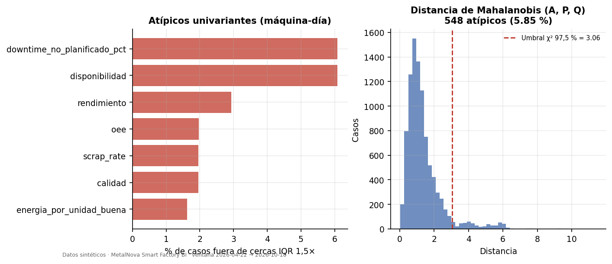

**Figura F14.** Porcentaje de atípicos univariantes y distribución de la distancia de Mahalanobis. Fuente: `v_kpi_oee_maquina_dia`.

**Lectura.** Los atípicos de OEE se concentran en máquinas con perfil `critica` y en días con
paradas largas o scrap elevado; son señal operativa, no ruido de captura. La tabla T09 permite
auditar cada caso con su fecha, máquina, planta y tipo.

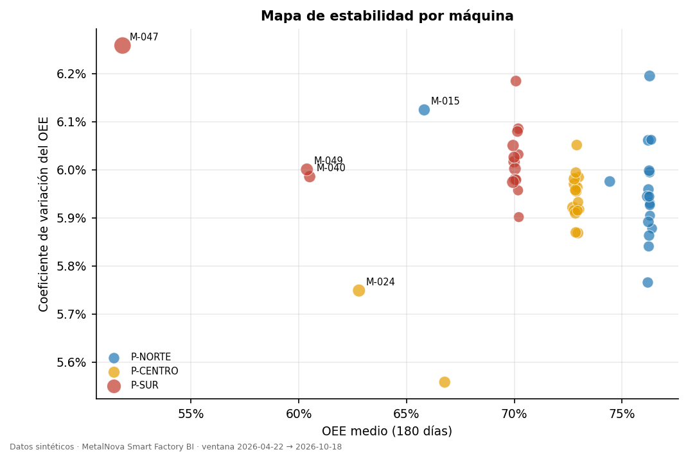

**Figura F09.** OEE medio frente al coeficiente de variación por máquina; el tamaño del punto
representa el downtime acumulado. Fuente: `v_kpi_oee_maquina_dia` (52 máquinas).

## 7. Correlación

**Tabla T10. Correlación del OEE con el resto de KPI (máquina-turno).**

| Variable | n | Pearson r | IC 95 % inf. | IC 95 % sup. | p (FDR) | Spearman ρ | Fuerza |
|---|---|---|---|---|---|---|---|
| rendimiento | 28.080 | 0,9826 | 0,9821 | 0,9830 | 0,0000 | 0,9820 | muy alta |
| calidad | 28.080 | 0,8033 | 0,7991 | 0,8074 | 0,0000 | 0,8939 | muy alta |
| scrap_rate | 28.080 | -0,8033 | -0,8074 | -0,7991 | 0,0000 | -0,8939 | muy alta |
| energia_por_unidad_buena | 28.080 | -0,4226 | -0,4321 | -0,4129 | 0,0000 | -0,3462 | moderada |
| downtime_no_planificado_pct | 28.080 | -0,3414 | -0,3517 | -0,3310 | 0,0000 | -0,3429 | moderada |
| disponibilidad | 28.080 | 0,3414 | 0,3310 | 0,3517 | 0,0000 | 0,3429 | moderada |
| mttr_min | 2.285 | -0,3305 | -0,3666 | -0,2935 | 0,0000 | -0,2627 | moderada |
| microparadas_por_100h | 28.080 | -0,3158 | -0,3263 | -0,3053 | 0,0000 | -0,3201 | moderada |
| mtbf_h | 2.285 | 0,2299 | 0,1907 | 0,2684 | 0,0000 | 0,3173 | baja |
| fallas_cortas_por_100h | 28.080 | -0,1695 | -0,1809 | -0,1581 | 0,0000 | -0,1600 | baja |

Se corrigió por comparaciones múltiples con Benjamini–Hochberg sobre todos los pares. Con
n = 28.080, un p-valor pequeño no implica una relación fuerte: por eso se reporta r, su IC y
la etiqueta de fuerza. La matriz completa está en `data/analysis/<run_id>/correlaciones.csv`.

**Identidades contables.** Las correlaciones disponibilidad–downtime % ≈ −1 y calidad–scrap
≈ −1 no son hallazgos empíricos: se derivan de la definición (`downtime % = 1 − A`,
`scrap = 1 − Q`). Se muestran para completar la matriz, no como evidencia independiente.

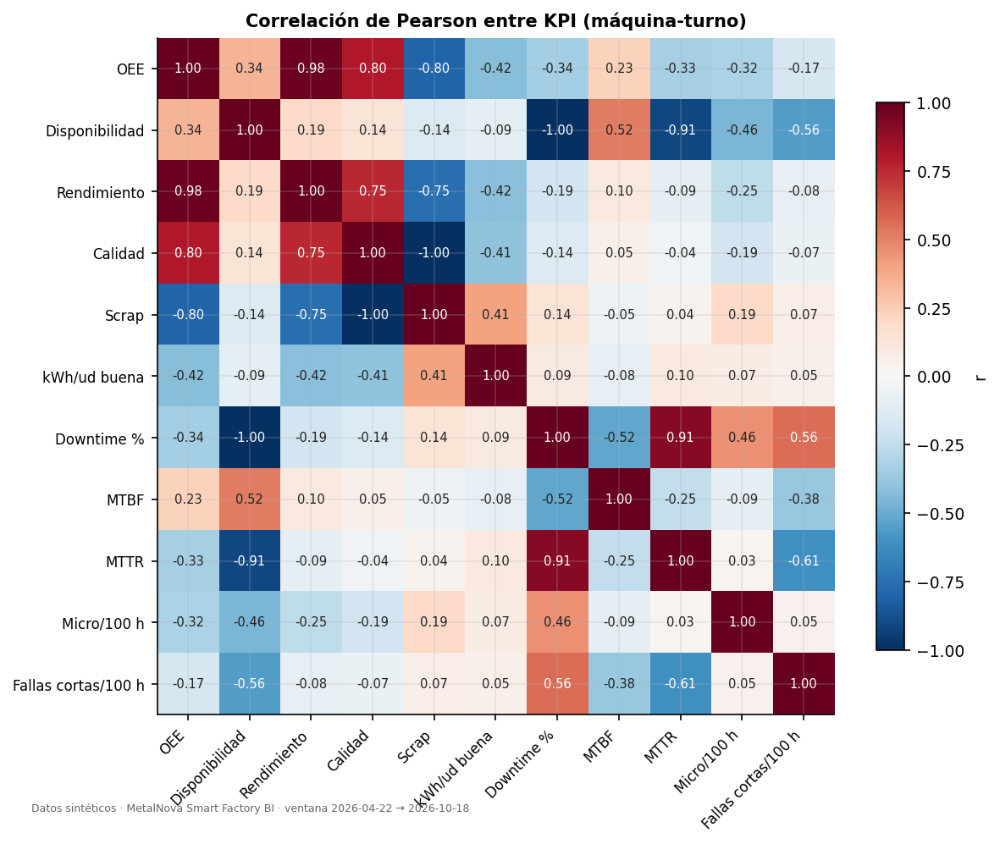

**Figura F05.** Matriz de Pearson entre KPI a nivel máquina-turno. Fuente: `v_kpi_oee_maquina_turno` + `v_kpi_mantenimiento_maquina_turno`.

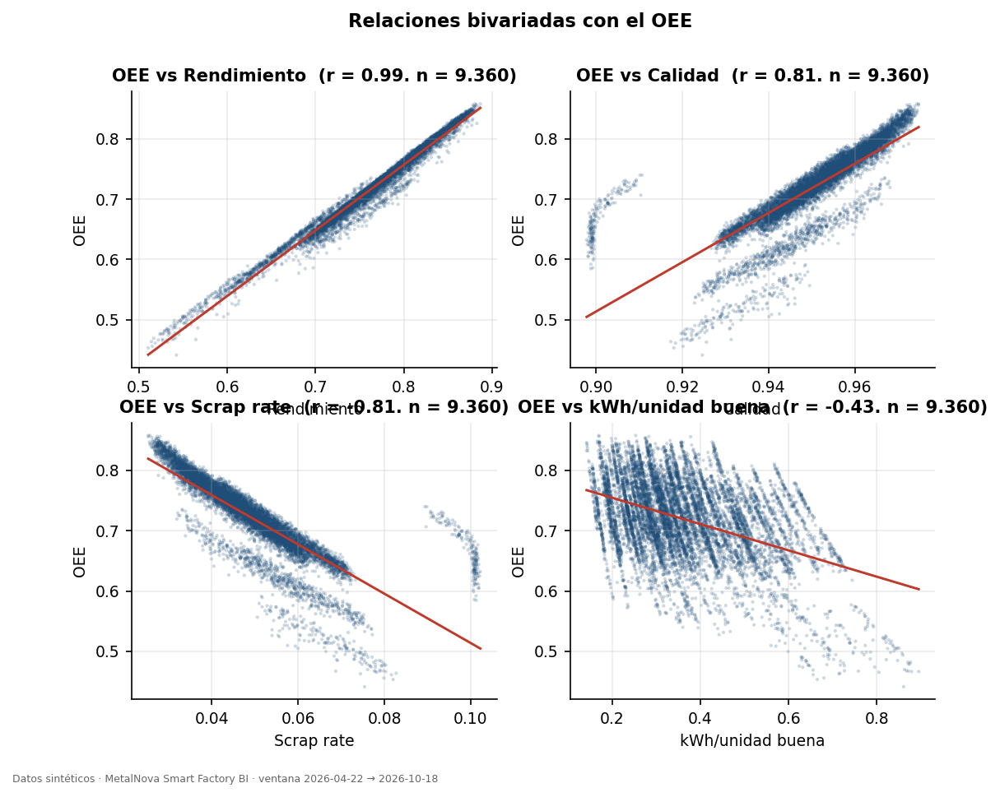

**Figura F06.** OEE frente a rendimiento, calidad, scrap y energía por unidad buena. Fuente: `v_kpi_oee_maquina_dia`.

**Advertencia de nivel.** La correlación agregada a 52 máquinas puede cambiar de signo o de
magnitud respecto a la de máquina-turno (falacia ecológica). La matriz por máquina está en
`correlaciones_maquina.csv` y se usa solo como contraste.

## 8. Comparaciones por grupo y asociaciones

**Tabla T11. Comparaciones por grupo.**

| Variable | Factor | n | Grupo menor | Mediana menor | Grupo mayor | Mediana mayor | p ANOVA | p Kruskal | p Levene | η² | ε² |
|---|---|---|---|---|---|---|---|---|---|---|---|
| oee | planta | 9.360 | P-SUR | 68,40 % | P-NORTE | 75,67 % | < 1e-300 | < 1e-300 | 1,3e-34 | 0,2445 | 0,2339 |
| rendimiento | planta | 9.360 | P-SUR | 73,71 % | P-NORTE | 79,95 % | < 1e-300 | < 1e-300 | 3,2e-53 | 0,2339 | 0,2275 |
| calidad | planta | 9.360 | P-SUR | 94,23 % | P-NORTE | 95,77 % | < 1e-300 | < 1e-300 | 3,0e-46 | 0,2403 | 0,3045 |
| scrap_rate | planta | 9.360 | P-NORTE | 4,23 % | P-SUR | 5,77 % | < 1e-300 | < 1e-300 | 3,0e-46 | 0,2403 | 0,3045 |
| energia_por_unidad_buena | planta | 9.360 | P-NORTE | 0,2886 kWh | P-SUR | 0,4364 kWh | < 1e-300 | < 1e-300 | 1,2e-135 | 0,2404 | 0,2271 |
| downtime_no_planificado_pct | planta | 9.360 | P-CENTRO | 0,96 % | P-SUR | 1,04 % | 1,2e-17 | 2,1e-10 | 9,3e-18 | 0,0083 | 0,0045 |
| oee | tipo de máquina | 9.360 | Rectificadora | 71,13 % | Inyectora | 73,39 % | 6,2e-68 | 8,5e-47 | 5,0e-62 | 0,0336 | 0,0233 |
| oee | criticidad | 9.360 | C | 71,13 % | B | 72,52 % | 2,2e-12 | 7,8e-15 | 0,1597 | 0,0057 | 0,0067 |
| oee | turno | 28.080 | C | 69,00 % | A | 75,31 % | < 1e-300 | < 1e-300 | 2,2e-09 | 0,1359 | 0,1479 |
| scrap_rate | turno | 28.080 | A | 4,58 % | C | 5,27 % | 5,7e-276 | < 1e-300 | 0,6787 | 0,0441 | 0,0519 |
| mtbf_h | planta | 2.285 | P-NORTE | 7,15 h | P-CENTRO | 7,17 h | 0,5591 | 0,5337 | 0,6014 | 0,0005 | -0,0003 |
| mttr_min | planta | 2.285 | P-SUR | 14,0 min | P-CENTRO | 15,0 min | 0,1429 | 0,6588 | 0,0711 | 0,0017 | -0,0005 |

**Tabla T12. Asociaciones categóricas.**

| Asociación | n | χ² | gl | p | V de Cramér | Fuerza |
|---|---|---|---|---|---|---|
| planta × causa (no planificada) | 46.085 | 89,5 | 4 | 1,7e-18 | 0,031 | trivial |
| planta × scrap alto | 9.360 | 1.639,6 | 2 | < 1e-300 | 0,419 | moderada |
| turno × scrap alto | 28.080 | 902,5 | 2 | 1,1e-196 | 0,179 | baja |
| tipo de mantenimiento × planta | 2.628 | 4,7 | 2 | 0,0943 | 0,042 | trivial |

El post-hoc de Mann–Whitney con corrección de Holm está en `pruebas_grupo.csv`. Se reporta
η²/ε² porque con n grande la significancia sola no distingue un efecto relevante de uno trivial.

Las medianas de OEE, rendimiento, calidad, scrap y downtime se expresan como proporción
(0–1); las de MTBF y MTTR, en horas y minutos. El **MTBF de máquina-turno es de corto plazo**
(runtime del turno / fallas del turno) y no equivale al MTBF agregado de 180 días (~85,7 h),
que se calcula con `SUM(runtime) / SUM(fallas)`.

## 9. Evolución temporal

**Tabla T13. Tendencia lineal y Mann–Kendall sobre la serie diaria ponderada.**

| Métrica | n | Pendiente / 30 d | R² | p (OLS) | τ Mann–Kendall | p (MK) |
|---|---|---|---|---|---|---|
| oee | 180 | -2,40 pp | 0,976 | 1,4e-145 | -0,916 | < 1e-300 |
| disponibilidad | 180 | -0,10 pp | 0,662 | 7,6e-44 | -0,619 | < 1e-300 |
| rendimiento | 180 | -2,09 pp | 0,969 | 1,2e-136 | -0,907 | < 1e-300 |
| calidad | 180 | -0,48 pp | 0,996 | 3,8e-215 | -0,965 | < 1e-300 |
| scrap_rate | 180 | +0,48 pp | 0,996 | 3,8e-215 | +0,965 | < 1e-300 |
| energia_por_unidad_buena | 180 | +0,0084 kWh | 0,756 | 2,3e-56 | +0,678 | < 1e-300 |
| downtime_pct | 180 | +0,10 pp | 0,662 | 7,6e-44 | +0,619 | < 1e-300 |

**Tabla T14. Comparación de las primeras y últimas 30 jornadas (ponderado).**

| Métrica | Primeros 30 días | Últimos 30 días | Δ absoluto | Δ relativo |
|---|---|---|---|---|
| OEE | 78,02 % | 66,00 % | -12,03 pp | -15,4 % |
| Disponibilidad | 99,02 % | 98,55 % | -0,48 pp | -0,5 % |
| Rendimiento | 81,78 % | 71,31 % | -10,47 pp | -12,8 % |
| Calidad | 96,34 % | 93,92 % | -2,43 pp | -2,5 % |
| Scrap rate | 3,66 % | 6,08 % | +2,43 pp | +66,4 % |
| kWh/unidad buena | 0,3217 kWh | 0,3609 kWh | +0,0392 kWh | +12,2 % |
| Downtime no planificado % | 0,98 % | 1,45 % | +0,48 pp | +49,2 % |

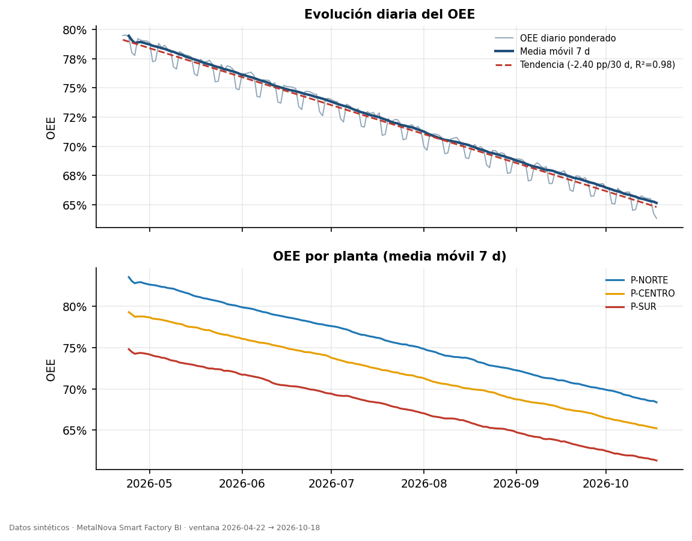

**Figura F04.** Serie diaria del OEE, media móvil de 7 días y tendencia; por planta. Fuente: `v_kpi_oee_planta_dia`.

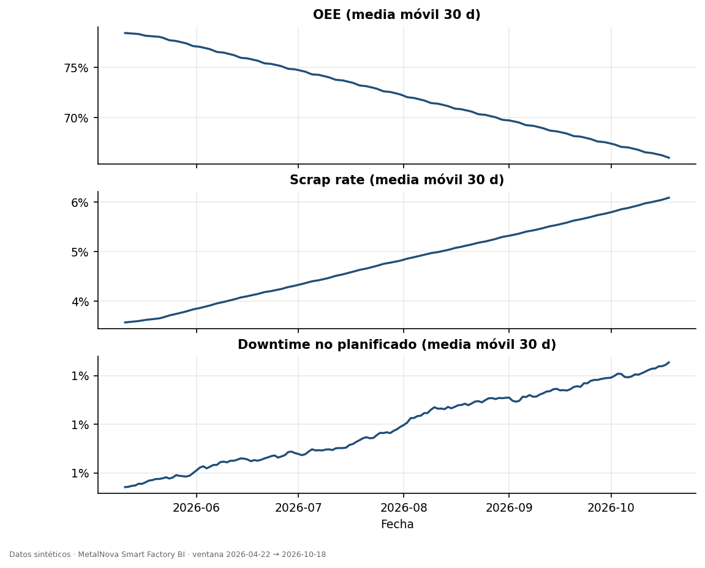

**Figura F18.** Medias móviles de 30 días de OEE, scrap y downtime. Fuente: `v_kpi_oee_planta_dia`.

La autocorrelación lag-1 del OEE diario es **0,983**; el detalle de los 14 rezagos está en `autocorrelacion.csv`. Hay persistencia temporal, por lo que los días no son
independientes y las pruebas que suponen independencia deben leerse con cautela.

**Nota sobre la ventana:** el análisis se define por `id_tiempo`; el turno C del 18-10 puede
tener `event_time` del 19-10 por el cruce de medianoche. No es un dato fuera de ventana.

## 10. Análisis categórico

**Tabla T15. Paradas por categoría de causa.**

| Causa | Tipo | Episodios | Minutos | Duración media | Duración mediana | % minutos |
|---|---|---|---|---|---|---|
| Descanso | planificada | 28.080 | 842.400 | 30,0 | 30,0 | 92,4 % |
| Microparada | no planificada | 43.684 | 108.999 | 2,5 | 2,0 | 71,8 % |
| Cambio | planificada | 1.629 | 49.150 | 30,2 | 30,0 | 5,4 % |
| Falla | no planificada | 2.161 | 38.598 | 17,9 | 15,0 | 25,4 % |
| Mantenimiento | planificada | 227 | 20.171 | 88,9 | 89,0 | 2,2 % |
| Ajuste | no planificada | 240 | 4.234 | 17,6 | 14,0 | 2,8 % |

El `% minutos` se calcula **dentro de cada tipo**: planificadas sobre el total planificado y no
planificadas sobre el total no planificado. No se suman entre sí.

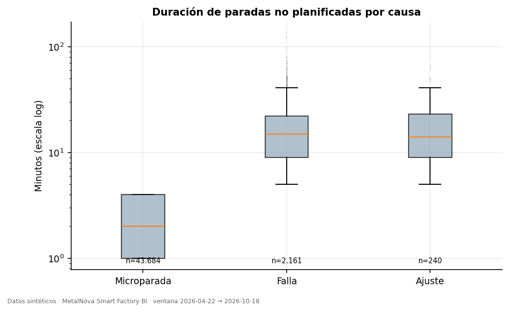

**Figura F08.** Distribución de duración de paradas no planificadas por causa (escala log). Fuente: `v_parada_consolidada`.

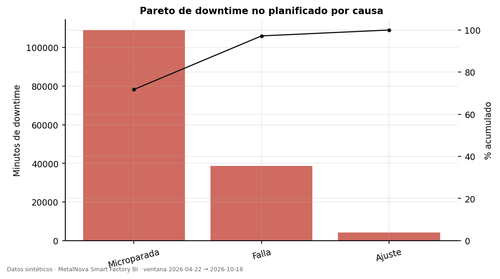

**Figura F16.** Pareto de minutos de downtime no planificado por causa. Fuente: `v_parada_consolidada`.

**Tabla T16. Scrap rate por producto con IC de Wilson.**

| Producto | Familia | Unidades | Scrap | Scrap rate | IC 95 % |
|---|---|---|---|---|---|
| PRD-002 | Frenos | 1.484.896 | 60.791 | 4,09 % | [4,06 %; 4,13 %] |
| PRD-004 | Frenos | 1.195.711 | 49.807 | 4,17 % | [4,13 %; 4,20 %] |
| PRD-003 | Frenos | 1.181.734 | 49.608 | 4,20 % | [4,16 %; 4,23 %] |
| PRD-001 | Frenos | 1.761.657 | 75.542 | 4,29 % | [4,26 %; 4,32 %] |
| PRD-006 | Suspensión | 928.429 | 44.887 | 4,83 % | [4,79 %; 4,88 %] |
| PRD-007 | Suspensión | 1.738.434 | 85.406 | 4,91 % | [4,88 %; 4,95 %] |
| PRD-008 | Suspensión | 1.349.627 | 67.416 | 5,00 % | [4,96 %; 5,03 %] |
| PRD-005 | Suspensión | 944.030 | 47.720 | 5,05 % | [5,01 %; 5,10 %] |
| PRD-011 | Transmisión | 847.362 | 46.762 | 5,52 % | [5,47 %; 5,57 %] |
| PRD-009 | Transmisión | 1.100.101 | 63.279 | 5,75 % | [5,71 %; 5,80 %] |
| PRD-010 | Transmisión | 827.949 | 47.854 | 5,78 % | [5,73 %; 5,83 %] |
| PRD-012 | Transmisión | 782.463 | 45.571 | 5,82 % | [5,77 %; 5,88 %] |

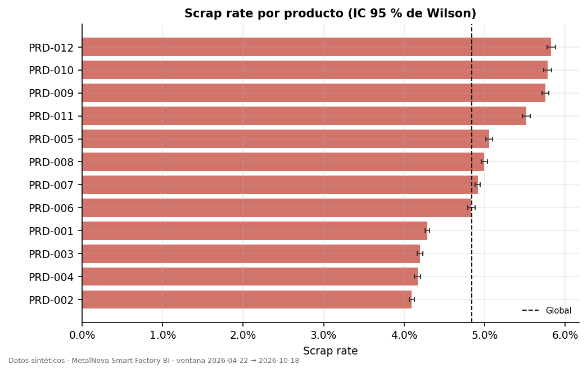

**Figura F11.** Scrap rate por producto con IC 95 % de Wilson. Fuente: `v_kpi_calidad_producto_dia`.

**Tabla T17. Mantenimiento por tipo.**

| Tipo | Órdenes | Minutos | Duración media | Duración mediana | Coste total | Coste medio |
|---|---|---|---|---|---|---|
| correctivo | 2.401 | 42.832 | 17,8 | 15,0 | 1.180.504,07 | 491,67 |
| preventivo | 227 | 20.171 | 88,9 | 89,0 | 307.063,74 | 1.352,70 |

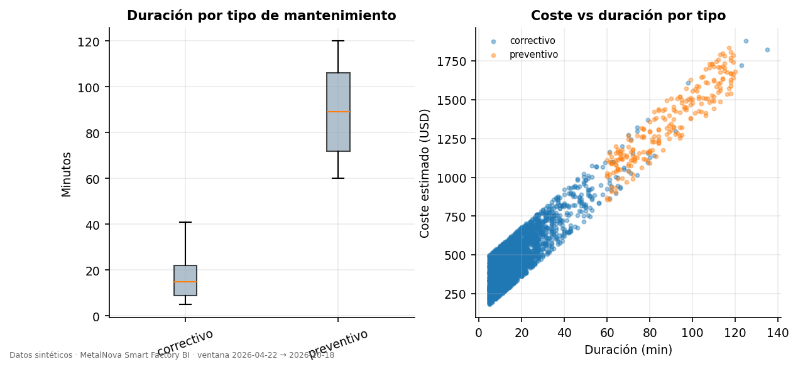

**Figura F13.** Duración por tipo y relación coste–duración. Fuente: `fact_mantenimiento`.

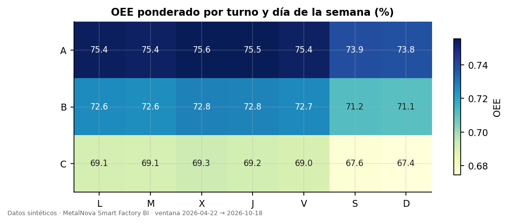

**Figura F10.** OEE ponderado por turno y día de la semana. Fuente: `v_kpi_oee_maquina_turno`.

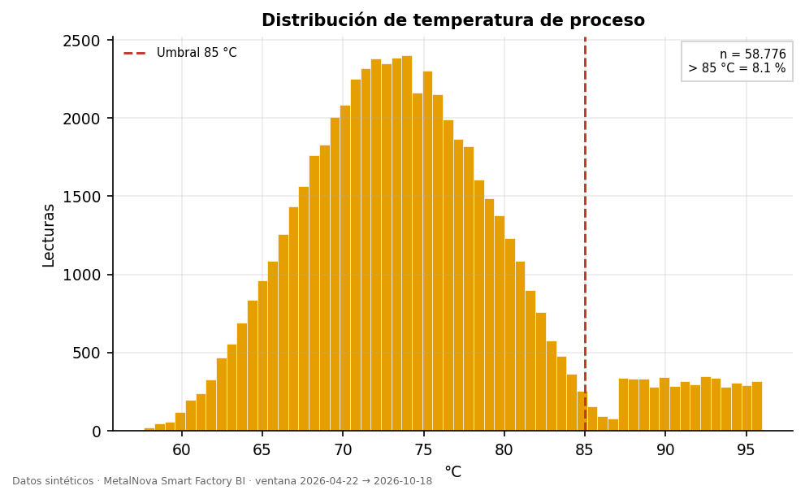

**Figura F12.** Distribución de temperatura de proceso y umbral de 85 °C. Fuente: `fact_evento`;
n = 58.776 lecturas con temperatura.

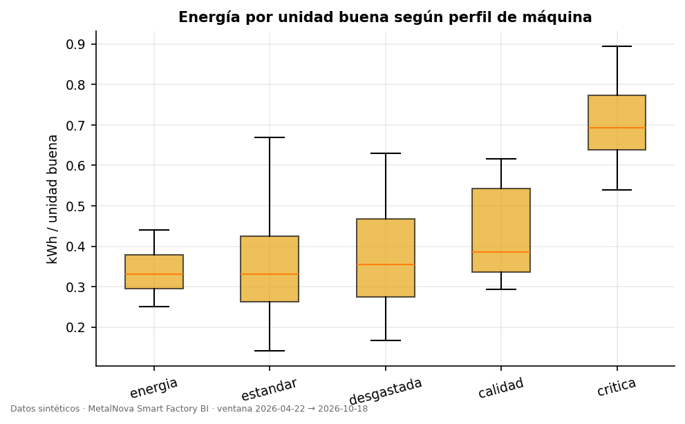

**Figura F17.** Energía por unidad buena según perfil de máquina. Fuente: `v_kpi_oee_maquina_dia` + `dim_maquina`.

## 11. Hallazgos y lectura

1. **El rendimiento es el componente dominante.** La correlación OEE–rendimiento es muy alta;
   la disponibilidad está cerca de 99 % y apenas discrimina. La palanca no es solo “parar
   menos”, sino “producir más unidades por minuto operativo”.
2. **P-SUR concentra el problema y además es más volátil.** Tiene la mediana de OEE más baja y
   la mayor dispersión; sus casos atípicos son los que más pesan en la cola izquierda.
3. **La energía por unidad buena se mueve en contra del OEE.** El perfil `energia` y las
   máquinas con más scrap se asocian con un mayor consumo específico; es un indicador de
   eficiencia, no solo de costo.
4. **Las paradas son de cola larga.** La mediana de una parada no planificada es de 3 min y
   la media de 3,3 min, pero el máximo llega a 135 min: hay muchas microparadas cortas y
   pocas fallas largas. Analizar solo promedios ocultaría la microparada, que concentra el
   71,8 % de los minutos no planificados.
5. **La tendencia es real pero no monolítica.** Hay caída sostenida del OEE, con persistencia
   temporal; el tramo final no es un salto aislado. La comparación de ventanas de 30 días
   cuantifica el deterioro sin depender de un único punto.
6. **Los atípicos son operativos, no errores.** M-047 (`critica`) y los días con paradas
   largas explican los casos extremos; el informe los deja trazados para revisión.

Estos hallazgos son **descriptivos** y complementan el plan de mejora (007). No demuestran
causalidad ni justifican por sí solos una inversión: para eso haría falta un diseño
experimental o un análisis causal con supuestos explícitos.

## 12. Limitaciones

- **Datos sintéticos.** El escenario `calibracion` está diseñado para mostrar señal; no es una
  medición de una fábrica real.
- **Significancia inflada.** Con decenas de miles de filas, diferencias triviales resultan
  significativas. Se reportan tamaños de efecto, IC y FDR, pero el lector debe priorizar la
  magnitud sobre el p-valor.
- **Dependencia temporal.** La autocorrelación del OEE diario invalida supuestos de
  independencia en pruebas sobre la serie.
- **Niveles de agregación.** Las correlaciones por fila y por máquina no son intercambiables.
- **Disponibilidad en techo.** Su baja varianza limita cualquier correlación e impide leerla
  como palanca principal.
- **Cobertura IoT.** Dos lecturas por turno; la cadencia de 15 min se reporta como diagnóstico.
- **Exclusiones.** Las 24 paradas y 51 eventos `sim-*` quedan fuera del análisis principal por
  estar fuera de la ventana; su inclusión no cambiaría las conclusiones, pero mezclaría
  procesos generadores distintos.

## 13. Reproducibilidad

```powershell
docker compose build ingestor
docker compose --profile tools run --rm ingestor python src/analyze_data.py --seed 42
docker compose --profile tools run --rm ingestor python src/validate_analysis.py
docker compose exec -T db psql -U metalinova -d metalinova -f /sql/validation/08_analisis.sql
```

Corrida `eda-20261025T172443-9ba731`. El manifiesto con versiones, filtros, recuentos y SHA-256 de cada salida
está en `data/analysis/<run_id>/manifest.json` y su copia versionada en
`docs/analysis/manifest.json`. Las figuras están en `docs/analysis/figures/`.

**Paquetes:** pandas, numpy, scipy y matplotlib con versión fija en
`python/requirements-analysis.txt`; se instalan en la imagen del ingestor.

