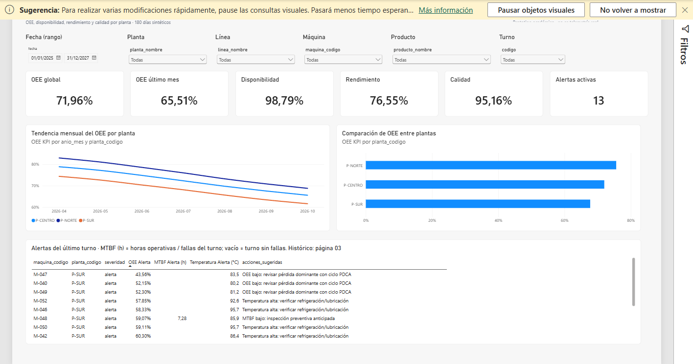

# Verificación — Incremento 006

Estado: **hecho** · Última actualización: 2026-10-23 · Entorno: PostgreSQL 16.4-alpine en
Docker (`metalinova_db`, healthy) · Power BI Desktop 2.159.883.0 (Microsoft Store).

Commits de esta etapa: `11224f9` (calibración, optimización de la alerta y TMDL), `0b2517f`
(corrección de `OEE Último Mes`), `ce39ae9` (páginas PBIR) y `c32cbd6` (OEE de alertas,
totales y drill-through). El cierre visual se registró el 2026-10-23.

## Criterios de aceptación

| AC | Comando/observación | Salida esperada | Salida observada | Fecha | Veredicto |
|---|---|---|---|---|---|
| AC-601 | revisar páginas del informe | 4 páginas, 9+ KPIs | 4 páginas visibles (Executive, OEE, Maintenance, Quality) con 24 tarjetas; confirmado por el usuario y por captura de las 4 páginas | 2026-10-23 | superada |
| AC-602 | comparar KPI informe vs vista SQL | coinciden | 10/10 tarjetas visibles tras el refresco: OEE global 71,96 %, OEE último mes visible (DAX 65,51 %), disponibilidad 98,79 %, rendimiento 76,55 %, calidad 95,16 %, MTBF 85,71 h, MTTR 17,84 min, FPY 97,63 %, energía 0,3403, alertas 13. El usuario confirmó la tarjeta corregida el 2026-10-22 | 2026-10-22 | superada |
| AC-603 | aplicar filtros en cada página | coherentes | 6 slicers sincronizados; el usuario verificó planta/turno entre páginas el 2026-10-23 | 2026-10-23 | superada |
| AC-604 | drill-through a máquina | navega a detalle | `pageBinding` Drillthrough corregido; el usuario probó «Obtener detalles» desde la tabla de confiabilidad el 2026-10-23 | 2026-10-23 | superada |
| AC-605 | revisar visuales | ninguno roto | captura de las 8 páginas vía `powerbi-report-author preview --all-pages`: 0 fallos; 4 páginas principales renderizan tarjetas, gráficos, matrices y tablas | 2026-10-23 | superada |
| AC-606 | mediciones DirectQuery/Import | documentadas | DirectQuery medido en el spike (D-019); T-616 redujo la alerta filtrada a 335–464 ms | 2026-10-21 | superada |
| AC-607 | revisar `powerbi/` | `.pbix`/`.pbip` presente | `powerbi/final/MetalNova.pbip` presente y abierto en Desktop; 8 páginas, 105 visuales | 2026-10-23 | superada |
| AC-608 | validar escenario calibrado | OEE ≈78 → 66 %, dispersión 5–10 pp, outlier <55 %, 49/49 | OEE 78,02 → 66,00 %; dispersión 8,5 → 7,3 pp; M-047 51,81 %; 49/49 OK | 2026-10-21 | superada |

## Calibración del histórico (T-617, FR-615)

Comando ejecutado (imagen `metalnova/ingestor:local` reconstruida):

```powershell
docker compose run --rm ingestor python src/generate_history.py `
  --seed 42 --days 180 --end-date 2026-10-18 --escenario calibracion
docker compose run --rm ingestor python src/load_history.py --reset
```

Identidad de la corrida: `run_id = hist-h3a58b2b659`, semilla 42, 180 días
(2026-04-22 → 2026-10-18), 52 máquinas. El `run_id` incluye el manifiesto de calibración, por lo
que dos configuraciones distintas no comparten identidad.

| Tabla | Filas |
|---|---:|
| `dim_orden` | 28.080 |
| `fact_produccion` | 28.080 |
| `fact_parada` | 76.021 |
| `fact_mantenimiento` | 2.628 |
| `fact_calidad` | 28.080 |
| `fact_evento` (histórico) | 401.787 |

Generación: 21,15 s · pico 42,8 MB. Carga: 89,15 s · pico 62,7 MB.

### OEE por ventanas de 30 días (medición SQL)

| Ámbito | Inicio | Cierre | Cambio |
|---|---:|---:|---:|
| Global | 0,7802 | 0,6600 | −12,02 pp |
| P-NORTE | 0,8198 | 0,6932 | −12,66 pp |
| P-CENTRO | 0,7800 | 0,6607 | −11,93 pp |
| P-SUR | 0,7344 | 0,6204 | −11,40 pp |
| Dispersión entre plantas | 8,5 pp | 7,3 pp | dentro de 5–10 pp |

A/P/Q global: inicio 0,9902 / 0,8178 / 0,9634; cierre 0,9855 / 0,7131 / 0,9392. El OEE global de
los 180 días es 0,7196 (A 0,9879 · P 0,7655 · Q 0,9516).

### Outliers persistentes (OEE de 180 días por máquina)

| Máquina | Planta | Perfil | OEE |
|---|---|---|---:|
| M-047 | P-SUR | `critica` | 0,5181 |
| M-049 | P-SUR | `desgastada` | 0,6037 |
| M-040 | P-SUR | `desgastada` | 0,6051 |
| M-024 | P-CENTRO | `desgastada` | 0,6278 |
| M-015 | P-NORTE | `desgastada` | 0,6581 |
| M-032 | P-CENTRO | `calidad` | 0,6679 |
| M-005 | P-NORTE | `energia` | — (outlier de consumo) |

Rango de OEE entre máquinas: 0,5181–0,7638. No se afirma que las cuatro máquinas estén por
debajo de 60 %: la medición da una por debajo de 55 % (M-047) y tres por debajo de 61 %.

### Scrap, downtime y energía (ventanas de 30 días)

| Métrica | Inicio | Cierre | Cambio |
|---|---:|---:|---:|
| Scrap | 3,66 % | 6,08 % | +2,42 pp |
| Downtime no planificado | 340 h | 508 h | +49,4 % |
| Energía por unidad buena | 0,3217 kWh | 0,3609 kWh | +12,2 % |

El caso orientativo menciona scrap 3,8 → 6,1 %, downtime +31 % y energía +14 %. Scrap y energía
quedaron cerca; el downtime relativo sigue por encima y se documenta como brecha, no como
coincidencia exacta.

### Validaciones posteriores

- `validate_data.py`: **49/49 comprobaciones OK**; diferencia máxima 2,22e-16 (tolerancia 1e-9).
- `sql/validation/03_calibracion.sql`: **7/7 comprobaciones OK** (OEE inicio 0,7802; cierre
  0,6600; dispersión 0,0853 / 0,0727; una máquina <55 %; tres <61 %; siete outliers).
- `verify_history.py`: **17/17 OK**; histórico con 43 eventos de la ingesta 004.
- Reproducibilidad: una segunda generación con la misma semilla, rango y escenario produjo los
  seis CSV con SHA-256 idéntico y el mismo `run_id`.
- `v_alerta_maquina_critica`: 28.101 filas; 3.284 `alerta`, 248 `critica`, 24.569 `sin_alerta`;
  13 alertas en el último turno por máquina.
- Último evento: `2026-10-22 02:01:15+00` (43 eventos y 21 paradas de la ingesta).
- Respaldo previo: `backups/metalinova_pre_calibracion_20261021.dump` (no versionado).

### Corrección de borde en la alerta

La calibración produjo un OEE exactamente igual a 0,5500000000000000000014 en M-047, turno 1
del 2026-06-28. La vista lo consideraba “no menor a 55 %” y la validación Python lo redondeaba de
otro modo. Se fijó la comparación con 6 decimales en la vista y en `validate_data.py`; el caso
borde ya coincide y la regla no cambia para valores distintos del umbral.

## T-616 · Optimización de la alerta

La vista usa `CROSS JOIN LATERAL` sobre las lecturas de proceso y el índice parcial
`ix_fact_evento_lectura_maquina_time`. Medición sobre el histórico calibrado:

```sql
EXPLAIN ANALYZE
SELECT count(*) FROM v_alerta_maquina_critica
WHERE fecha >= DATE '2026-09-19';
```

Resultados: **464 / 335 / 369 ms** en tres ejecuciones (antes de la optimización: 2.091 / 1.754
ms). La consulta sin filtro midió 347 ms en una ejecución. La validación independiente de la
regla sigue en 49/49, incluida la igualdad de `v_alerta` contra el cálculo Python.

## Modelo semántico (T-604)

`python tools/generate_tmdl.py` generó 12 tablas, 20 relaciones y 45 medidas;
`python tools/validate_model.py` devolvió:

```text
OK: 45 medidas, 20 relaciones, 12 tablas; referencias y tipos coherentes.
```

`v_dim_maquina` incluye la nueva columna `perfil_rendimiento`. El TMDL se regeneró después de la
calibración. La página de validación de T-604 se confirmó visualmente más tarde (2026-10-22):
las 10 tarjetas muestran valor.

### Incidencia T-604 · OEE último mes vacío

Tras el refresco, el usuario observó 9 de las 10 tarjetas correctas: `OEE Último Mes` mostraba
“— (Sin dato)”. La medición ADOMD confirmó la causa:

```text
OEE KPI global            = 0,719645392165132
MAX(dim_tiempo[anio_mes]) = 2027-12   (el calendario llega a 2027)
MAX(v_loss_tree[anio_mes]) = 2026-10  (los hechos terminan en 2026-10)
```

La medida original filtraba por el máximo del calendario, no por el último mes con hechos; al no
haber filas en 2027-12, `CALCULATE` devolvía vacío. Se cambió a:

```dax
OEE Último Mes =
VAR UltimoMes = MAX ( v_loss_tree[anio_mes] )
RETURN CALCULATE ( [OEE KPI], v_loss_tree[anio_mes] = UltimoMes )
```

La expresión equivalente se evaluó por ADOMD sobre el modelo en ejecución:
`0,655105074685` (octubre de 2026), coherente con el OEE del cierre. `tools/generate_tmdl.py`,
`measures.dax` y el TMDL quedaron corregidos. El usuario reabrió el `.pbip` y confirmó el
2026-10-22 que la tarjeta muestra valor; T-604 y T-605 quedan cerradas.

## Medición de modo de conexión (spike)

| Modo | Apertura | Cambio de filtro | Respuesta de visuales | Veredicto |
|---|---|---|---|---|
| DirectQuery | 35,46 s (mediana de 3) | 0,5 s tarjeta/línea; 2,64 s ventana completa | página 3,85 s; frescura 0,35 s | viable (D-019) |
| Import | — | — | no probado: DirectQuery cumplió los umbrales | — |

Umbrales acordados: apertura ≤ 60 s, cambio de filtro ≤ 5 s, frescura ≤ 60 s, 0 errores de
proveedor. Evidencia del spike en `logs/powerbi_spike_006.txt`,
`logs/PowerBIPerformanceFilter.json` y `logs/PowerBIPerformanceFreshness.json`.

## Generación de páginas PBIR (2026-10-22)

Comandos ejecutados:

```powershell
python tools/generate_tmdl.py
python tools/validate_model.py
python tools/generate_pbir.py
python tools/validate_report.py
```

Resultados observados:

```text
Modelo generado: 15 tablas, 27 relaciones, 70 medidas
OK: 70 medidas, 27 relaciones, 15 tablas; referencias y tipos coherentes.
Páginas generadas: 7 · Visuales: 94
Validación del informe PBIR: 8 páginas, 105 visuales, 0 errores
```

Páginas generadas: `01 Executive Plant Performance`, `02 OEE & Loss Tree`,
`03 Maintenance Reliability`, `04 Quality & Energy`, `Detalle máquina`,
`Detalle causa` y `Tooltip máquina`. La página `Modelo validado (T-604)` queda
oculta. `v_alerta_ultimo_turno` alimenta la tabla de alertas sin filtros
visuales; `v_kpi_calidad_producto_dia` hace coherente el filtro por producto.

**Verificación visual completada (2026-10-23):** el usuario abrió
`powerbi/final/MetalNova.pbip` y confirmó las 4 páginas, los filtros, el
drill-through y el tooltip. AC-601, AC-603, AC-604, AC-605 y AC-607 quedan
superadas; el detalle está en «Cierre visual».

## Calidad IoT (G5, 2026-10-22)

| Comprobación | Comando | Resultado | Veredicto |
|---|---|---|---|
| Clasificación y cuarentena | `python src/validate_iot.py` | 11/11 OK; limpieza correcta | superada |
| Escenario inválido | `simulate_events.py --scenario invalid M-001 --once` | 2 rechazos (`timestamp_futuro`, `timestamp_anterior_al_rango`); tardío con `tardio=true` y `reordenado=true` | superada |
| Vista de señal | `sql/validation/04_iot.sql` | 5/5 OK; 9.360 filas máquina-día; 52/52 máquinas | superada |

Detalle: `fact_evento_rechazado` conserva motivo y payload. El rango válido es
`[inicio_histórico − 1 d, ahora + 5 min]`. La cadencia ideal de 15 min se reporta
en `cumple_cadencia_15min`; el feed sintético emite 2 lecturas/turno (D-022).

## Corrección de tarjetas y tabla de alertas (2026-10-23)

Cambios aplicados tras la revisión visual del usuario:

- La tabla de alertas usa medidas de fila (`OEE Alerta`, `MTBF Alerta (h)`,
  `Temperatura Alerta (°C)`) en lugar de columnas crudas. El OEE se formatea como
  porcentaje y el MTBF como horas.
- `MTBF (h) = horas operativas / número de fallas` **del turno**. Una celda vacía
  significa que ese turno no tiene fallas o runtime; para el histórico de 180 días
  se usa la tabla de la página 03.
- Las tarjetas usan el visual `card` con `labelDisplayUnits = 1D` (sin unidades
  automáticas de miles/millones) y precisión fija: 0 para conteos, 2 para
  porcentajes/horas, 2 para USD y 4 para kWh/unidad.
- Convención de tiempos: **tarjetas en horas** (MTBF, MTTR, downtime y pérdida);
  **tablas y matrices en minutos** para el detalle operativo. La fórmula no exige
  una unidad concreta; es una decisión de presentación.
- La tarjeta de energía por unidad buena y la de energía total muestran `(kWh)`.
- `Costo Mantenimiento (USD)` conserva dos decimales: **$1.487.567,81**.
- La pérdida total del Loss Tree es **3.528.469 min = 58.807,82 h**; la tarjeta
  muestra horas y la matriz por planta mantiene minutos. Es coherente con
  OEE 71,96 %: 28,08 % del tiempo planificado (209.445 h).

Verificación estática: `validate_model.py` 70 medidas/27 relaciones/15 tablas y
`validate_report.py` 8 páginas/105 visuales, 0 errores. La confirmación visual
del usuario se registró el 2026-10-23.

## Corrección de la columna OEE y de la fila de totales (2026-10-23)

Tras el commit `32e7f70`, la columna `OEE Alerta` seguía vacía y la tabla
mostraba una fila `Total` al final.

**Causa raíz (columna vacía).** No era DAX ni el filtro: el modelo devolvía
`NULL` al materializar `v_alerta_ultimo_turno[oee]`. La vista SQL calculaba
`disponibilidad × rendimiento × calidad` como `numeric` sin escala; el producto
de tres ratios producía hasta ~60 decimales y el conector DirectQuery de Power BI
no podía convertirlos a `Double`. Con `dataAccessOptions.returnErrorValuesAsNull`
el error se ocultaba como celda vacía. `MTBF Alerta (h)` y
`Temperatura Alerta (°C)` sí funcionaban porque sus valores tienen ~17 y 2
decimales respectivamente.

Evidencia sobre el modelo abierto (ADOMD, `localhost:60978`):

```text
EVALUATE ROW("OEE", [OEE Alerta], ...)                 → [OEE Alerta] = <NULL>
EVALUATE ROW("MTBF", [MTBF Alerta (h)], ...)           → 7,31666666666667
EVALUATE ROW("Temp", [Temperatura Alerta (°C)], ...)   → 95,74
COUNTROWS(FILTER(..., NOT ISBLANK([oee])))             → 13  (el dato existe)
```

**Corrección aplicada.** En `sql/views/03_kpi_oee.sql`, las cinco vistas
`v_kpi_oee_*` redondean el OEE a 6 decimales:
`ROUND(disponibilidad * rendimiento * calidad, 6) AS oee`. Se reaplicaron
`03_kpi_oee.sql` y `08_alerta_maquina_critica.sql` sobre la base en ejecución.

Evidencia posterior (misma sesión ADOMD, sin reiniciar Power BI):

```text
[OEE Alerta] = 0,641481
M-002 → 0,616296 · M-047 → 0,435556 · M-028 (crítica) → 0,615741
```

**Fila de totales.** El visual `table_alertas` ahora declara
`objects.total[0].properties.totals = false` (generado desde
`tools/generate_pbir.py` con `totals=False`). El primer intento se escribió en
`objects.general`, que Power BI ignora: el catálogo oficial
(`powerbi-report-author formatting describe-object tableEx total`) confirma que
el objeto es `total` y la propiedad `totals` (bool). `validate_report.py` sigue
OK: 8 páginas, 105 visuales, 0 errores.

**Verificado.** El usuario confirmó el 2026-10-23 que `OEE Alerta` muestra
porcentajes y que la fila `Total` desapareció; la captura de la página 01 lo
muestra.

## Drill-through y tooltip: enlace de páginas (2026-10-23)

La auditoría estática del PBIR detectó que las páginas `Detalle máquina` y
`Detalle causa` tenían el filtro con `howCreated = "User"` y **no** declaraban
`pageBinding`. En ese estado Power BI no ofrece «Obtener detalles»: el
drill-through de AC-604/FR-607 no estaba operativo aunque la página existiera.

**Corrección.** `tools/generate_pbir.py` incorpora `drillthrough_page()`, que
genera la estructura que Power BI escribe al configurar drill-through:

- filtro de página con `howCreated = "Drillthrough"`,
- `pageBinding` tipo `Drillthrough` con `parameters[].boundFilter` apuntando a
  ese filtro y `fieldExpr` al campo (`maquina_codigo` / `categoria`).

La página `Tooltip máquina` recibe además `pageBinding` tipo `Tooltip` y el
filtro de `maquina_codigo`, para que el hover filtre por la máquina y no muestre
valores globales.

`tools/validate_report.py` ahora falla si una página Drillthrough no tiene el
filtro o el `boundFilter` correctos, si la página Tooltip no tiene su binding o
si falta el drill-through de máquina. Resultado actual: 8 páginas, 105 visuales,
0 errores.

**Verificado.** El usuario probó el drill-through a máquina y a causa el
2026-10-23: ambos navegan y filtran la página de detalle. El tooltip por máquina
también se mostró correctamente sobre la tabla de confiabilidad.

## Cierre visual (2026-10-23)

El usuario confirmó en Power BI Desktop:

1. Página 01: tarjetas y tabla de alertas correctas, sin fila `Total`.
2. Página 02: matriz máquina-turno con formato condicional.
3. Drill-through de máquina desde la tabla de confiabilidad.
4. Tooltip con MTBF, MTTR y última intervención.
5. Drill-through de causa desde el Pareto.
6. Slicers sincronizados entre páginas.

Además se capturaron las 8 páginas con
`powerbi-report-author preview "powerbi/final/MetalNova.pbip" --host desktop --screenshot <dir> --all-pages`
(0 fallos). La captura de la página 01 muestra `OEE Alerta` entre 43,56 % y
64,15 % y la tabla sin fila de totales. La fila `Total` que conservan la matriz
máquina-turno y la tabla de confiabilidad es intencional: solo se pidió quitarla
de la tabla de alertas.

El informe abre correctamente; la referencia de apertura sigue siendo la mediana
de 35,46 s de D-019 (umbral ≤ 60 s).

### Capturas

Guardadas en [`docs/capturas/`](../../docs/capturas/README.md) (2026-10-23,
datos sintéticos).

| Página | Captura |
|---|---|
| 01 Executive Plant Performance | [`01-executive.png`](../../docs/capturas/01-executive.png) |
| 02 OEE & Loss Tree | [`02-oee-loss-tree.png`](../../docs/capturas/02-oee-loss-tree.png) |
| 03 Maintenance Reliability | [`03-maintenance.png`](../../docs/capturas/03-maintenance.png) |
| 04 Quality & Energy | [`04-quality-energy.png`](../../docs/capturas/04-quality-energy.png) |
| Detalle máquina | [`detalle-maquina.png`](../../docs/capturas/detalle-maquina.png) |
| Detalle causa | [`detalle-causa.png`](../../docs/capturas/detalle-causa.png) |
| Tooltip máquina | [`tooltip-maquina.png`](../../docs/capturas/tooltip-maquina.png) |



## Cierre del incremento

Incremento 006 cerrado. Sin pendientes.
